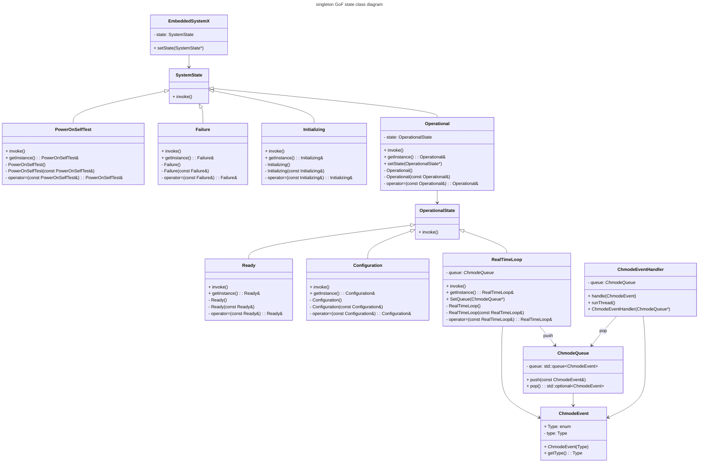
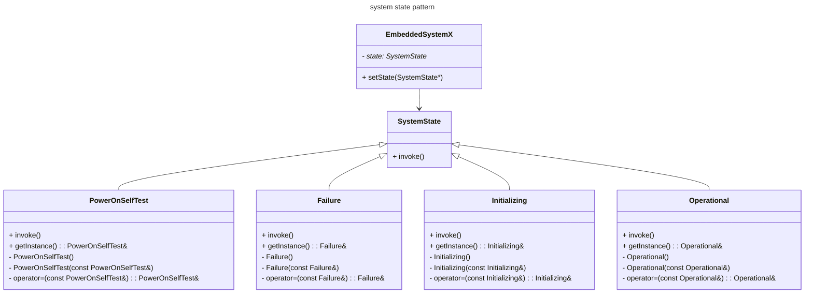
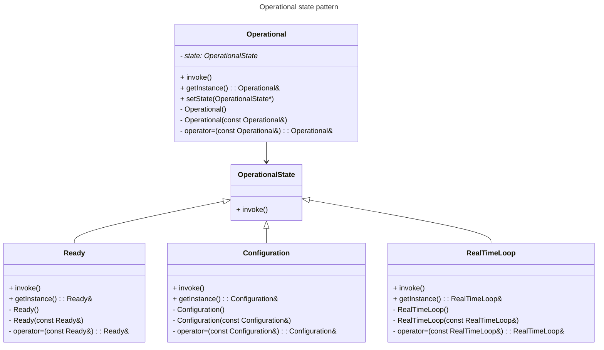
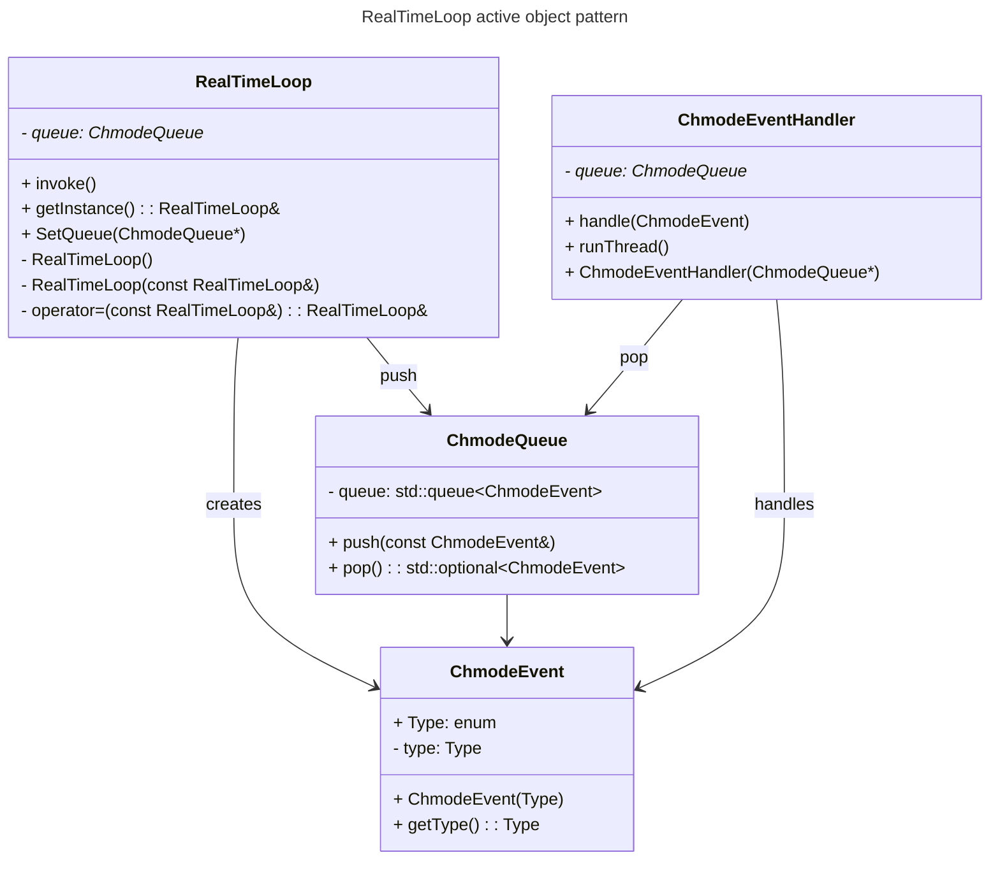

## State pattern: system

## State pattern: Operational substates

## Active object pattern: RealTimeLoop

## Libraries

The used c++ libraries:

- iostream: To output the states etc.
- threads: For running the handler asynchronously
